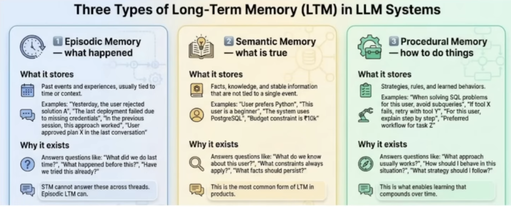

## LLM Memory:
A LLM at inference is just a parameterized math function.

### Stateless Function:
But this parameterized math function is stateless.

```bash
y = fo(x)
```

A system is stateless if it's output depends only on the current input, and not on anything that happened before.

Example of statelessness:
```python
from dotenv import load_dotenv
from langchain_openai import ChatOpenAI

load_dotenv()

llm = ChatOpenAI()

llm.invoke("My name is Asheesh")

llm.invoke("What is my name")
```

It won't be able to reply with my name. As it does not have any memory of past conversation.

Facts:
- LLMs don't have any intrinsic memory.
- Memory is essential concept in any LLM based application.
- We need to build the app with LLM and memory around it.

### Context Window:
The context window is the amount of text an LLM can read and remember at one time before answering.


### In-context learning:
It is an emergent ability that allows an LLM to use information and patterns present in the prompt itself, in addition to its trained parametric knowledge, to generate an answer.

## Short Term Memory:
Short term memory lets your application remember previous interactions within a single thread or conversation.

Problems with short term memory:
- It is fragile.
- Context window problem.
    - Trimming and Summarization are solution to context window problem.
- STM is thread scoped.
    - Loss of user contninuity across conversations.
    - Learning never compounds overtime.
    - Cross-thread reasoning is impossible.

Solution - We need a new kind of memory
- Information that should survive:
    - beyond a single conversation
    - beyond a single session
    - sometimes even beyond days or weeks

This is the kind of information that defines continuity.

Things like:
- who the user is
- how the system is expected to behave for them
- what tends to work and what usually fails
- what decisions were already made in the past

It has to be selective. Only information that proves to be stable, useful, and reusable should survive beyond a single thread. Everything else should naturally fade away.

## Long Term Memory:



### How does Long Term Memory work?
`Step 1 - Creation/update`

"Is anything from what just happened worth remembering beyond this conversation?"

What the system looks at
- User messages
- Model responses
- Tool outcomes

What happens in this step
The system:
- extracts memory candidates
- filters out noise
- decides scope (user / agent / app)
- decides whether to:
    - create a new memory
    - update an existing one
    - ignore it

`Step 2 - Storage`
"Where and how do we keep this memory?"

What storage actually means?
- Writing mempry to a durable store
- Assigning identifiers and metadata
- Making it survive restarts and crashes

Depending on the memory type, this might be:
- a relational database
- a key-value store
- a log
- a vector database (for semantic lookup)

`Step 3 - Retrieval`
"Given the current situation, what should I remember right now?"

What retrieval involves?

The system:
- looks at the current input
- decides whether memory is needed
- searches memory stores
- selects a small, relevant subset

Key point: Retrieval is selective, not exhaustive.

`Step 4 - Injection`

"How does memory actually influence the model?"

What injection really is?
- Retrieved memory is inserted into STM
- It becomes part of the prompt
- The model sees it as just more tokens


### The Challenges with LTM
1. Deciding what is worth remembering
2. Retrieving the right memory at the right time
3. Orchestrating the entire system


### Tools in market for Long term memory handling:
- [Langmem](https://www.langchain.com/blog/langmem-sdk-launch)
- [mem0](https://mem0.ai/)
- [supermemory](https://supermemory.ai/)