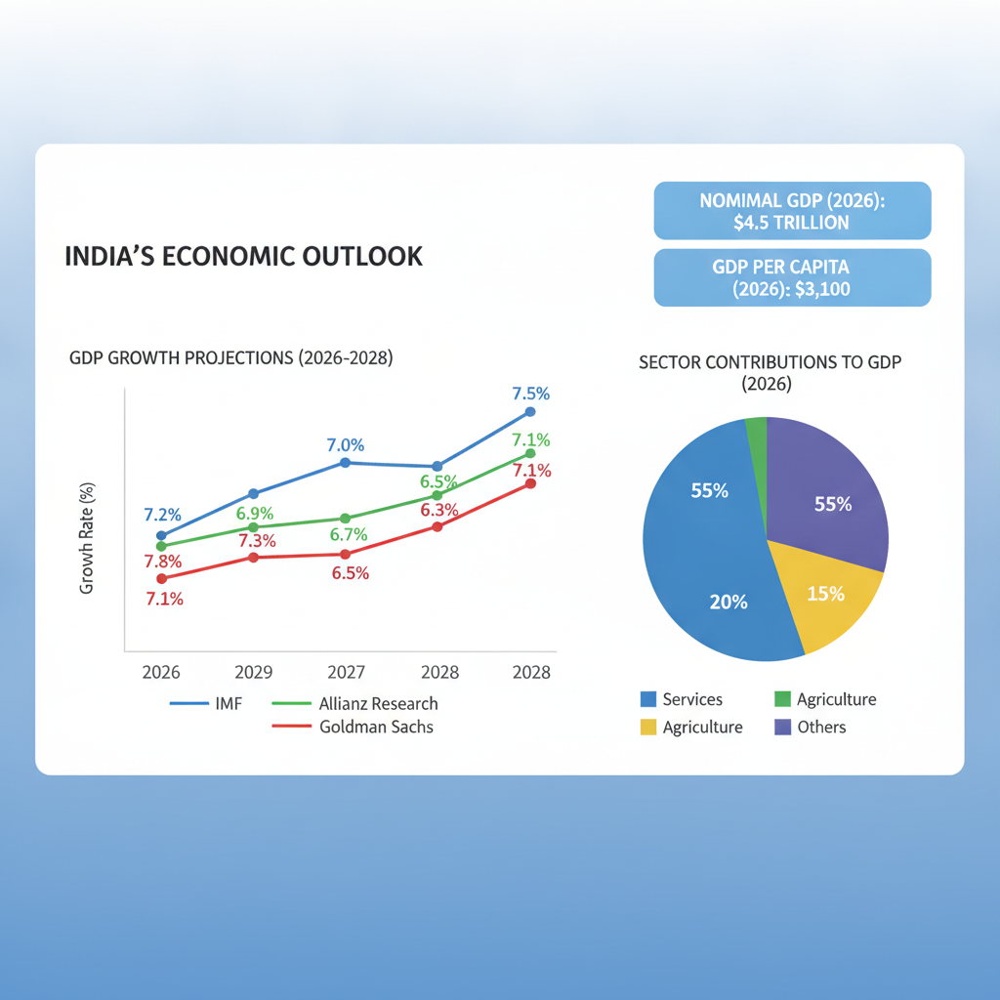
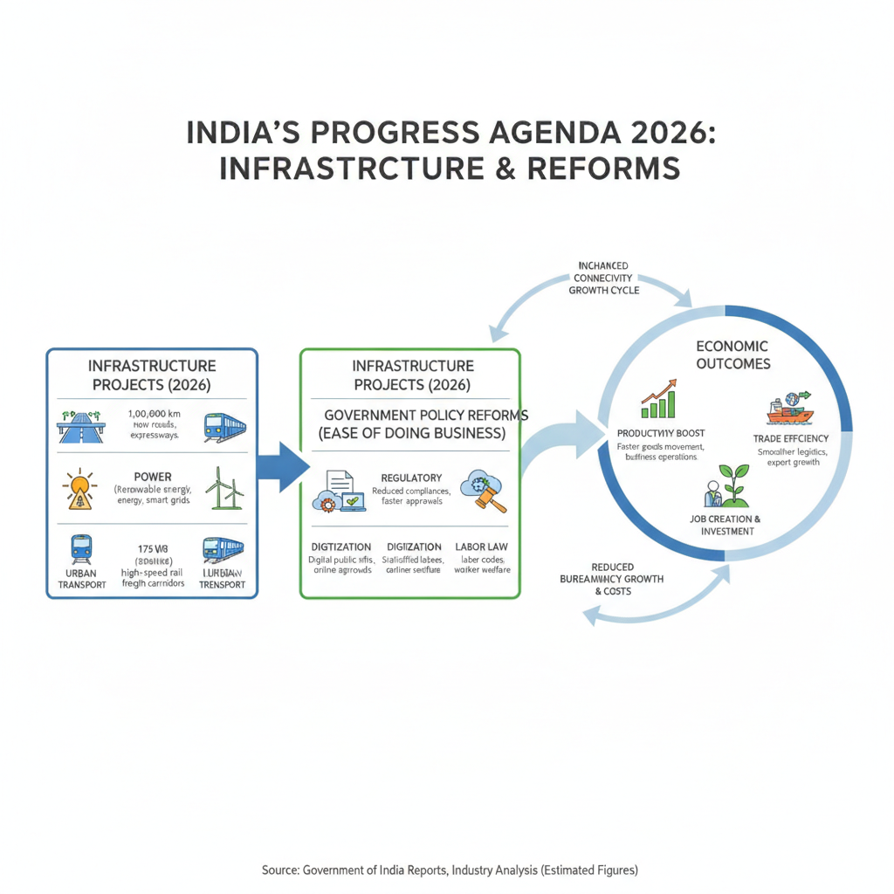
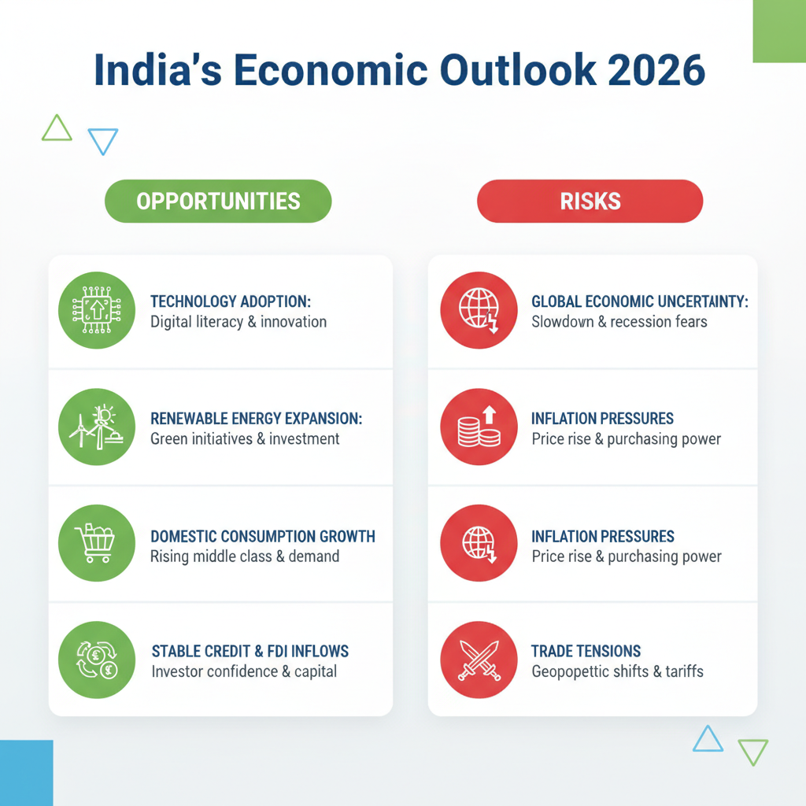

# India as an Emerging Economy: Growth, Challenges, and Opportunities in 2026

## Overview of India’s Economic Growth in 2026

India continues to cement its status as a leading emerging market with robust economic growth in 2026. According to multiple expert forecasts, including the International Monetary Fund (IMF), Allianz Research, and Goldman Sachs, India’s GDP growth rate is projected to range between 7.0% and 7.5% for the year. Allianz Research anticipates a GDP growth of 7.5% in 2026, moderating slightly to 7.1% in 2027 and 6.8% in 2028, reflecting a gradual but steady economic momentum [[Source](https://bfsi.economictimes.indiatimes.com/articles/indias-gdp-growth-seen-at-7-5-in-2026-to-moderate-to-7-1-in-2027-and-6-8-in-2028-allianz-research/134560287)]. Meanwhile, the IMF has raised India’s 2026 growth forecast to 7%, keeping India as the fastest-growing major economy within the G20 grouping [[Source](https://www.ibef.org/news/imf-raises-india-s-2026-growth-forecast-to-7-citing-resilient-domestic-demand)][[Source](https://www.youtube.com/watch?v=WJf-aaTFFtw)].

When compared over the 2026–2028 horizon, this moderate decline in growth rates indicates a sustainable pace that mitigates overheating risks while benefiting from ongoing structural reforms and investments. Goldman Sachs highlights the positive outlook amid new trade agreements, projecting resilience built on expanding domestic consumption and improving export dynamics [[Source](https://www.goldmansachs.com/insights/articles/the-outlook-for-indias-economy-in-2026-amid-new-us-tradedeal)]. These estimates underscore India’s accelerating economic momentum as it transitions into a more consumption-driven and service-oriented economy.

To provide scale, India’s nominal GDP in 2026 is estimated to exceed $3.7 trillion (USD), positioning the country as the third-largest economy globally by nominal GDP [[Source](https://www.worldometers.info/gdp/india-gdp)]. GDP per capita, while still below many advanced economies, is projected to reach approximately $2,800, indicating rising average incomes and a burgeoning middle class fueling domestic demand.

*Projected GDP growth rates and sector-wise contribution to India's economy in 2026.*

The primary drivers behind India’s resilient growth include robust domestic demand powered by increasing consumer spending, urbanization, and a dynamic services sector. The services sector contributes nearly 55% of GDP and continues to expand rapidly, especially in IT, financial services, and telecommunications. Domestic consumption remains the backbone of growth, supported by government stimulus measures, rising employment, and increased access to credit. Furthermore, investment flows—particularly foreign direct investment, which reached $3.3 billion in September 2026—are incentivized by reforms aimed at improving the business environment [[Source](https://www.thehindu.com/business/Economy/net-fdi-at-33-billion-in-september-2026-positive-for-third-consecutive-month/article71617131.ece)].

In conclusion, India’s economic trajectory in 2026 reflects a balanced combination of rapid growth and improving structural fundamentals. As the fastest-growing major economy in the G20, it offers expanding opportunities driven by robust domestic demand and a thriving services sector, making it a focal point for policymakers, investors, and economists monitoring global economic shifts.

## Key Sectors Fueling India’s Economic Expansion

India’s rapid economic growth in 2026 is underpinned by several key sectors that collectively drive GDP expansion, employment, and investment inflows. Understanding the dynamics across these sectors offers valuable insights into the structural transformation of one of the world’s fastest-growing economies.

### Services Industry: The Growth Engine

The services sector remains the dominant contributor to India’s GDP, accounting for over 50% of the total economic output. In 2026, services continue to catalyze growth through expanding IT and software services, financial services, telecommunications, and retail. This sector’s robust domestic demand and increasing integration with the global economy support its pivotal role in GDP growth, projected to sustain the country’s overall GDP forecast of around 7% for 2026 ([IMF](https://www.ibef.org/news/imf-raises-india-s-2026-growth-forecast-to-7-citing-resilient-domestic-demand)). The digital transformation and the rise of startups further fuel innovation and employment within services.

### Manufacturing and Communication: Attracting Foreign Direct Investment

Manufacturing in India is expanding as a key pillar for enhancing economic diversification and boosting exports. The government’s “Make in India” initiative combined with strategic investments in electronics, automotive, and pharmaceuticals has attracted significant foreign direct investment (FDI). In September 2026 alone, net FDI inflows reached $3.3 billion, continuing a positive trend for three consecutive months, reflecting foreign investors’ confidence in manufacturing and communication sectors ([The Hindu](https://www.thehindu.com/business/Economy/net-fdi-at-33-billion-in-september-2026-positive-for-third-consecutive-month/article71617131.ece)). Communication services, including broadband and mobile connectivity, are also rapidly growing, benefiting from expanded infrastructure and rising consumer demand.

### Agricultural Sector: Backbone of Rural Stability

Despite rapid urbanization, agriculture remains a vital sector for India by providing sustenance, rural employment, and income stability. Growth in agricultural productivity through technological adoption and sustainable practices ensures food security and underpins rural consumption—critical for regional economic balance. Recent monsoon arrivals and improved supply chain logistics have helped the sector perform steadily in 2026, supporting overall economic resilience and poverty reduction.

### Infrastructure Development: Foundation for Capacity Expansion

Government-led investments in infrastructure are crucial enablers of economic growth. Projects spanning highways, railways, ports, power generation, and urban transport have accelerated capacity expansion and reduced logistic bottlenecks. The infrastructure sector in India is estimated to have substantial market size growth, driven by policy initiatives promoting public-private partnerships and increased capital outlay ([IBEF](https://www.ibef.org/industry/infrastructure-sector-india)). This creates multiplier effects by improving connectivity and lowering the cost of business operations across industries.

### Policy Reforms: Improving Business Environment and Sector Growth

A series of policy reforms in 2026 continue to streamline regulations, enhance ease of doing business, and boost sectoral competitiveness. These include tax rationalization, labor market reforms, and regulatory clarity in key sectors such as manufacturing and digital services. Trade facilitation measures and investment protections nurture a favorable climate for innovation and expansion. Such reforms are critical for sustaining the growth momentum and attracting global capital, thereby reinforcing India’s position as a compelling emerging market for investors and policymakers alike.

---

Together, these sectors illustrate a multifaceted growth trajectory for India in 2026, marked by dynamic services expansion, manufacturing resilience backed by FDI, agricultural stability, robust infrastructure development, and progressive policy reforms. For stakeholders, recognizing these sectoral drivers is essential to tapping into India's growth opportunities while addressing challenges in an evolving global economic landscape.

## The Role of Foreign Direct Investment in India’s Emergence

Foreign Direct Investment (FDI) plays a pivotal role in India’s economic ascent, underpinning growth and future global positioning. In 2026, India has witnessed sustained inflows of FDI, reflecting investor confidence amid robust GDP growth forecasts. According to recent data, net FDI inflows totaled approximately $3.3 billion in September 2026 alone, marking the third consecutive month of positive gains and signaling the continuation of strong foreign capital interest in the Indian market ([The Hindu](https://www.thehindu.com/business/Economy/net-fdi-at-33-billion-in-september-2026-positive-for-third-consecutive-month/article71617131.ece)). This growth aligns with broader economic expansion, as India’s GDP is projected to grow around 7% in 2026, reinforcing its status as one of the world’s fastest-growing major economies ([IMF / IBEF](https://www.ibef.org/news/imf-raises-india-s-2026-growth-forecast-to-7-citing-resilient-domestic-demand)).

Key sectors attracting the bulk of foreign investment in 2026 include information technology, infrastructure, manufacturing, and renewable energy. The IT sector benefits from India’s skilled labor pool and digital innovation capabilities, while infrastructure investments are driven by government initiatives aimed at improving connectivity and logistics ([IBEF Infrastructure Sector](https://www.ibef.org/industry/infrastructure-sector-india)). Additionally, the renewable energy sector appeals to environmentally conscious global investors seeking opportunities in sustainable development. Factors encouraging investment range from India’s large domestic market and rising consumer demand to policy reforms that ease foreign participation and improve ease of doing business.

The Indian government and the Reserve Bank of India (RBI) have implemented several initiatives that catalyze FDI inflows. Policies such as sector-specific liberalization, rationalization of foreign ownership caps, and infrastructure-focused public-private partnerships have created a conducive environment for investment. Furthermore, the RBI maintains supportive monetary policies balancing inflation control with growth facilitation, ensuring steady capital flows despite external volatility ([Trading Economics](https://tradingeconomics.com/india/foreign-direct-investment)).

FDI’s impact on the Indian economy extends beyond capital injection. Foreign investments stimulate job creation by expanding industrial capacities and nurturing entrepreneurship, notably in the burgeoning startup ecosystem ([UpForge 2026 Startup Report](https://upforge.org/blog/india-startup-ecosystem-2026)). Technology transfer from multinational corporations fosters innovation and enhances productivity, elevating India’s competitiveness in global value chains. Furthermore, FDI-driven industrial growth supports the diversification of the economy, reducing dependence on traditional sectors and positioning India as a key player in advanced manufacturing and services.

Nevertheless, challenges persist. Global trade uncertainties, including fluctuating tariffs and geopolitical tensions, can disrupt capital flows and investor sentiment. Additionally, volatility in global markets impacts risk perceptions, which may affect long-term investment commitments. India must also address infrastructure bottlenecks and regulatory complexities to maintain its attractiveness for foreign investors.

For policymakers and investors, sustaining FDI momentum requires continuous reforms, transparent governance, and strategic engagement in multilateral trade dialogues. Enhancing skill development and innovation ecosystems will maximize the benefits of foreign investment for inclusive growth. By balancing these dynamics, India can consolidate its emerging economy status and harness FDI as a catalyst for sustained prosperity in the coming decade.

## Inflation and Price Stability: Challenges for Sustainable Growth

In 2026, India is grappling with persistent inflationary pressures that pose significant challenges to its economic stability and growth prospects. Recent data indicates that the Consumer Price Index (CPI) inflation has hovered around 6.5% for much of the year, slightly above the Reserve Bank of India’s (RBI) target range of 4% ±2%. Food inflation, a critical component affecting the majority of households, has been especially volatile, averaging near 7% due to supply chain disruptions and erratic monsoon patterns [Source](https://www.mospi.gov.in/uploads/latestreleasesfiles/1791801549227-Press%20Release%20for%20the%20month%20of%20September,%202026.pdf). Energy prices have also risen steadily amid global oil market uncertainties and a weakening Indian rupee, further exacerbating overall inflationary trends [Source](https://tradingeconomics.com/india/inflation-cpi).

Several factors underpin these inflation dynamics. The depreciation of the rupee against major currencies has raised import costs, especially for crude oil, which powers a substantial share of India’s energy mix. Concurrently, lingering supply chain constraints and elevated food commodity prices have pressured consumer prices upward. These inflation drivers are partly externallinked to geopolitical events and global market volatilitybut also reflect domestic structural issues such as agricultural productivity challenges and infrastructure bottlenecks [Source](https://www.ibef.org/industry/infrastructure-sector-india).

The RBI has maintained its flexible inflation targeting framework, aiming to balance price stability with growth objectives. In 2026, the RBI responded to inflation pressures through calibrated interest rate hikes and liquidity tightening measures to anchor inflation expectations without stifling investment. While the central bank succeeded in preventing a sharp rise in inflation, persistent supply-side constraints limit the efficacy of monetary policy in fully curbing price increases [Source](https://tradingeconomics.com/india/inflation-cpi).

Inflation’s impact on the Indian economy is multifaceted. For consumers, rising prices erode purchasing power, particularly among low- and middle-income groups, leading to shifts in spending patterns and potential demand contraction in some sectors. For businesses, inflation increases input costs, squeezing profit margins and complicating pricing decisions. This environment creates uncertainty, potentially dampening private investment and slowing capital formation necessary for sustained growth [Source](https://www.ibef.org/news/imf-raises-india-s-2026-growth-forecast-to-7-citing-resilient-domestic-demand).

Looking ahead, inflation trends will critically influence India’s investment climate and macroeconomic stability. Policymakers must enhance supply-side efficiencyimproving agricultural productivity, strengthening logistics infrastructure, and managing energy coststo contain inflationary pressures sustainably. For investors and policymakers alike, understanding the evolving inflation landscape is essential to making informed decisions that balance growth ambitions with economic resilience. In sum, while India’s growth trajectory remains robust, achieving price stability will be vital for supporting inclusive and sustainable development in the years ahead.

## Government Policies and Infrastructure Enhancements Supporting Growth

India’s emergence as a rapidly growing economy in 2026 is strongly underpinned by strategic government initiatives focused on infrastructure development and policy reforms. In the fiscal year 2026-27, the government has planned an ambitious capital outlay exceeding ₹10 trillion, targeting critical sectors including transport, power, and urban infrastructure [Source](https://www.ibef.org/industry/infrastructure-sector-india). This sizable investment reflects a commitment to addressing core infrastructural gaps to sustain high growth rates predicted by leading analysts.

Key infrastructure projects spearhead this transformation. The expansion of national highways is a priority, with over 15,000 km of new roads and expressways under development to enhance connectivity and reduce logistics costs. Simultaneously, upgrades to power generation capacity, especially renewable energy projects, are accelerating to meet rising industrial and residential demand, contributing to energy security and environmental goals. These efforts collectively aim to facilitate smoother movement of goods and services and foster inclusive development across regions.

On the policy front, India has implemented reforms designed to improve the ease of doing business. These include simplified regulatory frameworks, digitization of government services, and streamlined labor laws, recommendations strongly endorsed by economic analysts for boosting investor confidence and operational efficiency [Source](https://www.oecd.org/en/topics/sub-issues/economic-surveys/india-economic-snapshot.html). Improvements in transparency and dispute resolution mechanisms are also being pursued to create a more predictable business environment.

The link between infrastructure progress and economic outcomes is clear: enhanced transport and energy systems raise productivity, reduce transaction costs, and improve trade efficiency domestically and internationally. This directly strengthens the investment climate, attracting both foreign and domestic capital, as reflected in recent net FDI inflows surpassing $3 billion monthly [Source](https://www.thehindu.com/business/Economy/net-fdi-at-33-billion-in-september-2026-positive-for-third-consecutive-month/article71617131.ece).

Fiscal policy measures play a supportive role in sustaining growth momentum. The government has maintained a balanced approach by increasing public spending on infrastructure while managing inflationary pressures through monetary coordination [Source](https://tradingeconomics.com/india/inflation-cpi). This prudent fiscal stance ensures continued economic recovery amid global uncertainties, helping India maintain its position as one of the fastest-growing major economies, with GDP growth forecasts around 7% in 2026 [Source](https://www.ibef.org/news/imf-raises-india-s-2026-growth-forecast-to-7-citing-resilient-domestic-demand).

*Overview diagram of India's key infrastructure projects and policy reforms driving economic growth in 2026.*

In summary, India’s government policies and infrastructure investments in 2026 create a robust foundation for sustained economic expansion. By prioritizing connectivity, clean energy, and regulatory reforms, the nation is enhancing productivity and trade competitiveness—key prerequisites for long-term economic resilience and inclusive growth. Stakeholders should continue to monitor these developments closely, as they offer significant opportunities across sectors and regions.

## Future Outlook: Opportunities and Risks for India as an Emerging Market

India’s medium-term growth trajectory remains robust, with GDP expected to expand at a strong pace through 2028. Leading forecasts, including those from Allianz Research and the IMF, project GDP growth of approximately 7% in 2026, moderating slightly to around 6.8% by 2028 [Source](https://bfsi.economictimes.indiatimes.com/articles/indias-gdp-growth-seen-at-7-5-in-2026-to-moderate-to-7-1-in-2027-and-6-8-in-2028-allianz-research/134560287). This sustained expansion is underpinned by key drivers such as domestic consumption, infrastructure investments, and a growing services sector, buoyed by digital transformation initiatives and a young workforce.

However, the growth outlook is not without its risks. Global economic uncertainties, including potential slowdowns in advanced economies, could dampen export demand and foreign investment flows. Inflation remains a key concern, with recent data indicating persistent upward pressure on consumer prices driven by energy costs and supply chain disruptions [Source](https://tradingeconomics.com/india/inflation-cpi). Additionally, escalating trade tensions—particularly in the context of evolving US trade policies—pose challenges to India’s export competitiveness and supply chain resilience [Source](https://www.goldmansachs.com/insights/articles/the-outlook-for-indias-economy-in-2026-amid-new-us-tradedeal).

Despite these headwinds, significant opportunities exist in several high-growth sectors. Technology adoption, especially in areas like fintech, artificial intelligence, and digital services, is accelerating, supported by a vibrant startup ecosystem and government digitization programs [Source](https://upforge.org/blog/india-startup-ecosystem-2026). The green energy transition presents another major growth avenue, as India aggressively expands renewable energy capacity to meet domestic demand and climate commitments. Meanwhile, an expanding middle class is driving domestic consumption, creating scalable opportunities for both consumer goods and services industries.

Supporting this growth is an improving financial environment marked by stable credit availability and increasing foreign direct investment, which reached $3.3 billion in September 2026—a positive sign for sustained capital inflows [Source](https://www.thehindu.com/business/Economy/net-fdi-at-33-billion-in-september-2026-positive-for-third-consecutive-month/article71617131.ece). Furthermore, regulatory reforms aimed at easing business processes, enhancing infrastructure, and fostering innovation contribute to a more conducive environment for investment and enterprise development [Source](https://www.ibef.org/industry/infrastructure-sector-india).

*Balanced overview of opportunities and risks shaping India’s emerging market status in 2026 and near future.*

**Recommendations for stakeholders:**  
- **Policymakers** should prioritize maintaining inflation within target ranges, strengthen trade diversification strategies, and accelerate green infrastructure investments to capitalize on global sustainability trends.  
- **Investors** need to focus on sectors with high innovation potential, such as tech startups and clean energy, while maintaining vigilance on geopolitical and inflation-driven risks.  
- **Business leaders** are advised to leverage digital transformation and adapt supply chains to mitigate trade disruptions, while tapping into evolving consumer preferences within India’s growing domestic market.

In sum, India’s emerging market status is backed by strong fundamentals and dynamic sectors, but requires proactive risk management and strategic planning to fully realize its medium-term growth potential.