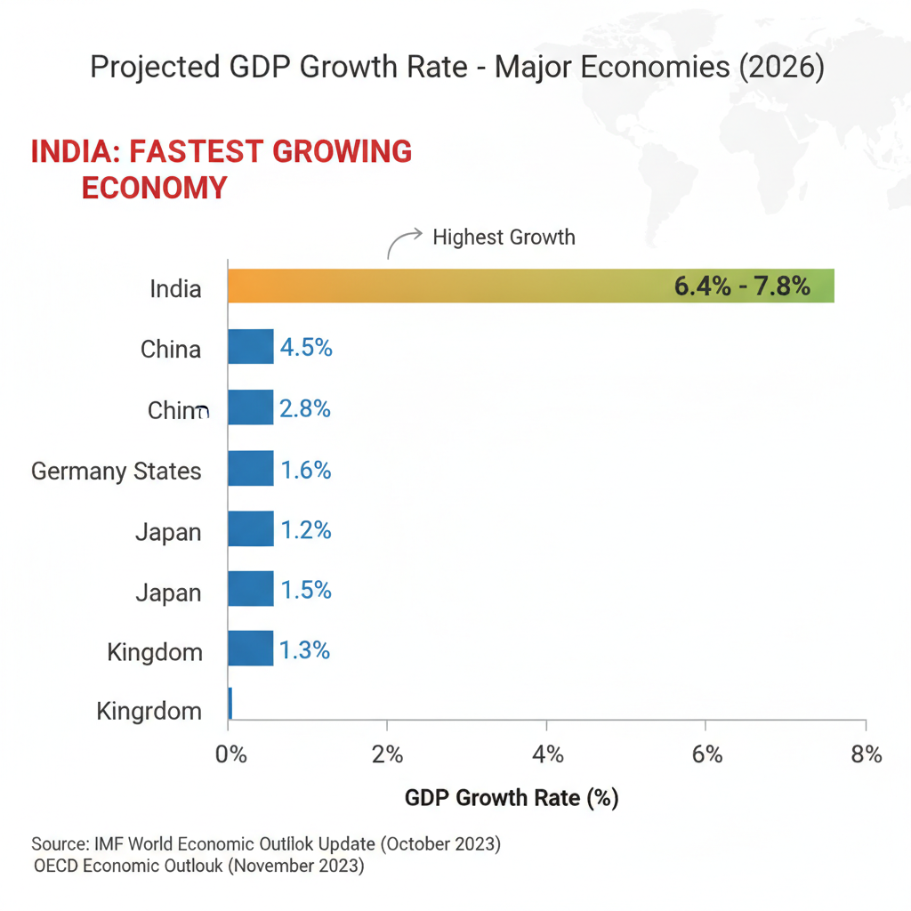
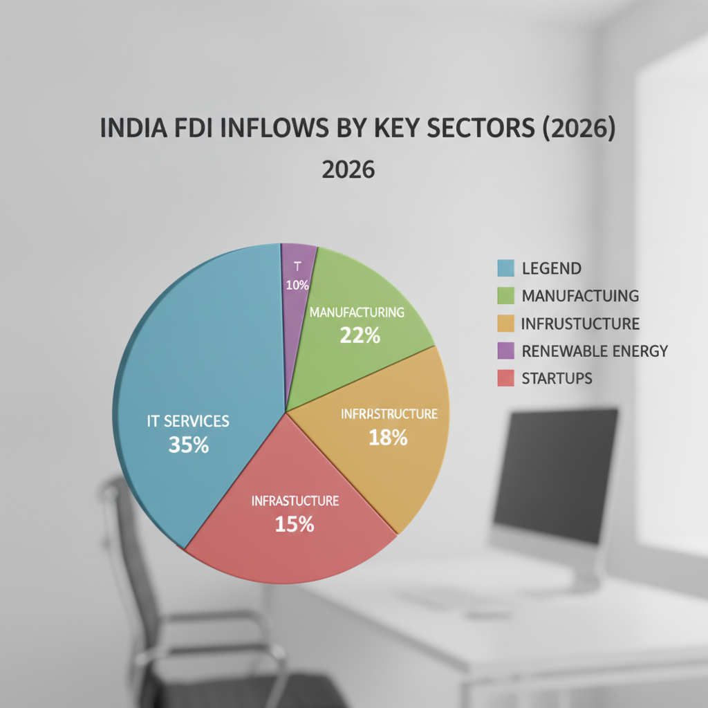
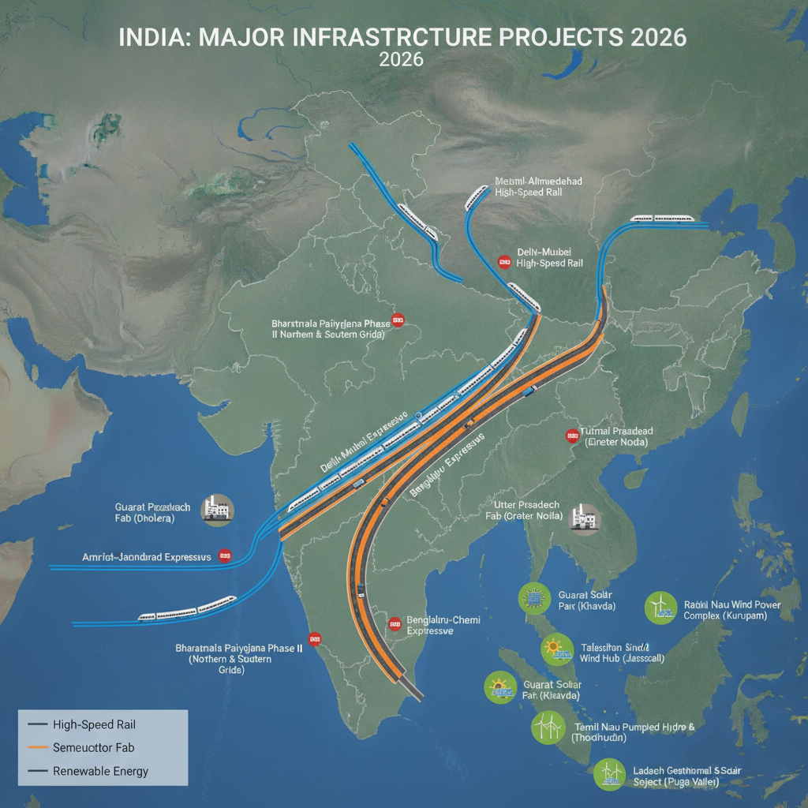

# India as an Emerging Economy in 2026: Trends, Opportunities, and Challenges

## Overview of India's Economic Growth in 2026

India’s economy in 2026 continues to demonstrate remarkable resilience and dynamism, positioning itself firmly as the fastest growing major economy worldwide. According to the International Monetary Fund's World Economic Outlook January 2026 update, India’s GDP growth rate is estimated at **6.4% for both 2026 and 2027** [Source](https://www.facebook.com/inbministry/posts/india-is-projected-to-retain-its-position-as-the-fastest-growing-major-economy-i/1335719745255444). Some estimates, including those from market analysis firms, place this figure even higher, around **7.8% for 2026**, highlighting a strong upward revision fueled by robust domestic demand and policy momentum [Source](https://boldvoices.in/indian-economy-achievements-2026).

The drivers behind this sustained growth are multifaceted. The **manufacturing sector** has seen notable expansion due to government incentives and Make in India initiatives, boosting industrial output significantly. Exports continue to be a key contributor, with India diversifying its trade partners and product base despite global disruptions, maintaining a positive trade balance [Source](https://tradingeconomics.com/india/balance-of-trade). The **services sector**, led by IT and digital services, remains a powerhouse, accounting for a substantial share of GDP and employment. Additionally, unprecedented investment in **infrastructure** has accelerated progress on major projects such as highways, renewable energy plants, and urban development, which are boosting productivity and regional connectivity [Source](https://www.ibef.org/industry/infrastructure-sector-india).

Compared to a global landscape marked by economic slowdown and decelerated growth in many advanced economies, India’s momentum stands out. The United Nations forecasts a robust **6.6% GDP expansion in 2026** for India, underscoring its relative economic stability and high growth trajectory even as global conditions remain volatile [Source](https://english.mathrubhumi.com/news/money/un-projects-india-gdp-growth-2026-vmr13q9o). This continued outperformance is significant since it ensures India’s rising influence in global markets and enhances its investment appeal.

Government reforms have been pivotal, including streamlined regulatory frameworks, tax rationalization, and sustained efforts to improve the ease of doing business. The impact of enhanced Foreign Direct Investment inflows—netting $3.3 billion in September 2026 alone—is a clear signal of international investor confidence spurred by policy reforms and sector-specific incentives [Source](https://www.thehindu.com/business/Economy/net-fdi-at-33-billion-in-september-2026-positive-for-third-consecutive-month/article71617131.ece). In parallel, the government’s focus on technological adoption, digital infrastructure, and workforce skill development is fostering innovation-driven growth.

For investors and policy makers, these trends present actionable insights: India’s growth is not only high but increasingly broad-based across sectors, reflecting a maturing economic structure. Strategic investments in infrastructure and manufacturing, supported by a favorable policy environment and demographic advantages, position India to sustain this growth momentum through 2027 and beyond. Staying attuned to these developments and leveraging governmental reform pathways can unlock significant economic opportunities and mitigate emerging challenges.

*India's GDP growth rates versus major economies in 2026 showing India's leading position.*

## Foreign Direct Investment (FDI) Trends and Implications

India's Foreign Direct Investment (FDI) landscape in 2026 continues to demonstrate strong momentum, reinforcing the country's position as a premier destination for global capital. Net FDI inflows have shown a positive trajectory, with September 2026 registering $3.3 billion—marking the third consecutive month of growth in net investments [Source](https://www.thehindu.com/business/Economy/net-fdi-at-33-billion-in-september-2026-positive-for-third-consecutive-month/article71617131.ece). This consistent inflow reflects growing investor confidence amid India's robust economic expansion.

Sector-wise, technology-driven industries like IT services and startups remain prime attractors of FDI, buoyed by India's vibrant startup ecosystem and digital innovation initiatives [Source](https://upforge.org/blog/india-startup-ecosystem-2026). Additionally, manufacturing and infrastructure sectors continue to capture substantial foreign investment. For instance, infrastructure projects across states such as Maharashtra, Tamil Nadu, and Gujarat are drawing significant capital, aligning with government efforts to upgrade transport, energy, and urban facilities [Source](https://www.ibef.org/industry/infrastructure-sector-india). These states have cultivated investor-friendly environments through streamlined procedures and policy support, intensifying their appeal.

Government reforms have played a pivotal role in this uptrend. Progressive liberalization of FDI norms, ease of doing business reforms, and strategic public-private partnership models have all contributed to reducing entry barriers and enhancing transparency. Recent policy frameworks explicitly encourage foreign participation in emerging sectors, including renewable energy and digital services, positioning India for sustainable growth.

FDI inflows significantly underpin expansion in industrial and service sectors. Capital inflows facilitate the modernization of manufacturing units, adoption of advanced technologies, and scale-up of service operations. This investment surge supports India's projected GDP growth, which is expected to be in the range of 6.4% to 7.8% in 2026, depending on sources [Source](https://boldvoices.in/indian-economy-achievements-2026). Moreover, foreign investment accelerates technology transfer, enabling domestic firms to enhance productivity and innovation capacity.

The implications for employment are substantial. Increased FDI fuels job creation across sectors, particularly in high-skill areas such as IT, fintech, and advanced manufacturing. It empowers workforce development through training and exposure to international best practices. However, dependence on FDI also entails challenges, including vulnerability to global market fluctuations and potential crowding out of local enterprises if foreign firms dominate key sectors.

In summary, while FDI remains a critical lever for India's economic dynamism and sectoral growth, policymakers and investors must balance attraction of foreign capital with strategies to mitigate associated risks. Continued reform, infrastructure enhancement, and workforce readiness will be essential in maximizing the benefits of FDI for inclusive and resilient growth.

## Infrastructure Development: Backbone of Economic Transformation

India’s rapid economic ascent in 2026 is deeply intertwined with an ambitious infrastructure agenda, positioning the country for sustained industrial growth and enhanced global trade competitiveness. Key infrastructure projects underway embody this strategic thrust. Among the flagship initiatives is the expansion of high-speed rail networks, notably the Mumbai-Ahmedabad bullet train, set to revolutionize connectivity between major economic hubs with reduced travel times and increased passenger capacity. Concurrently, highway development continues apace, with the Bharatmala Pariyojana project aiming to add over 34,800 km of roads, facilitating more efficient logistics and inter-state commerce. In the tech manufacturing arena, India is advancing its ambition to become a semiconductor hub by greenlighting multiple semiconductor fabrication plants, crucial for reducing reliance on imports and bolstering electronics production domestically [Source](https://www.constructionplacements.com/top-10-infrastructure-projects-india-2026), [Source](https://www.ibef.org/industry/infrastructure-sector-india).

Capital investment into infrastructure has witnessed marked growth, reflecting government priorities to accelerate economic transformation. In FY2026, infrastructure sector investments have grown by over 15% compared to previous years, with a significant portion allocated to renewable energy projects and power generation capacity enhancements. India’s power sector is expanding with large-scale solar and wind projects, targeting a net-zero emissions trajectory while ensuring stable industrial energy supply. Transport infrastructure complements this by improving last-mile connectivity and port modernization to bolster export efficiency [Source](https://www.ibef.org/industry/infrastructure-sector-india), [Source](https://www.pib.gov.in/PressReleasePage.aspx?PRID=2323944&reg=48&lang=2).

These infrastructure improvements serve as the scaffolding for industrial expansion and trade facilitation. Enhanced transport corridors reduce transit times and costs, directly impacting manufacturing and supply chain competitiveness. The semiconductor fabs and power projects attract high-tech industries and startups, encouraging innovation hubs that increase export value addition. Together, these projects improve India’s integration within global value chains while easing domestic business operations, thus reinforcing the country’s position as a preferred investment destination [Source](https://upforge.org/blog/india-startup-ecosystem-2026).

Public-private partnerships (PPPs) continue to play a pivotal role, leveraging private capital and expertise to accelerate project completion. Innovative financing models such as infrastructure investment trusts (InvITs) have gained traction, enabling institutional and retail investors to fund large-scale infrastructure projects while securing steady returns. The government’s emphasis on transparent procurement and risk-sharing frameworks has improved PPP outcomes, with sectors like highways, urban transport, and energy witnessing significant private sector participation [Source](https://www.ibef.org/industry/infrastructure-sector-india).

However, challenges remain. Land acquisition delays and regulatory complexities often slow project execution timelines. Environmental concerns surrounding large infrastructure projects—such as deforestation, water resource impacts, and pollution—necessitate more robust sustainability frameworks to balance growth with ecological preservation. Addressing these issues is critical to maintaining investor confidence and achieving long-term development goals [Source](https://www.constructionplacements.com/top-10-infrastructure-projects-india-2026).

Ultimately, India’s infrastructure investments form the backbone of its improved economic competitiveness and export capacity. By reducing logistical bottlenecks, ensuring reliable power supply, and fostering technology-driven industrial clusters, the country is laying the foundation for enhanced productivity and broader integration into global markets. For investors and policymakers alike, aligning strategies with infrastructure development trends offers actionable pathways to capitalize on India’s growth momentum in 2026 and beyond.

## Trade Dynamics: Export Growth and Trade Deficit Trends

In 2026, India continues to navigate complex trade dynamics shaped by strong export growth and persistent trade deficits. Recent data reveals that India’s exports surged to approximately $450 billion in the fiscal year 2025-26, supported by diverse sectors, while imports remained higher at around $600 billion, resulting in a trade deficit close to $150 billion. This widening gap reflects ongoing reliance on energy imports and intermediate goods necessary for robust domestic production [Source](https://tradingeconomics.com/india/balance-of-trade).

Export growth is driven predominantly by the manufacturing and services sectors. Key contributors include pharmaceuticals, textiles, engineering goods, and information technology-enabled services (ITES), which together contribute nearly 20% to GDP. The pharmaceutical sector, in particular, has leveraged India’s competitive advantages in R&D and skilled labor, boosting exports by nearly 12% year-on-year. Additionally, the leather and automotive parts industries have shown notable international demand, improving India’s export composition [Source](https://boldvoices.in/indian-economy-achievements-2026).

The Indian government has introduced several initiatives to enhance export competitiveness. The recently revamped Foreign Trade Policy emphasizes incentives for technology-intensive exports and aims to reduce regulatory bottlenecks through digital platforms. Schemes like the Production Linked Incentive (PLI) continue to promote high-value manufacturing, while export hubs and logistics corridors are being developed under the National Infrastructure Pipeline to streamline supply chains and reduce transit times [Source](https://www.pib.gov.in/PressReleasePage.aspx?PRID=2323944&reg=48&lang=2).

Nevertheless, the trade deficit poses challenges, especially amid global supply chain disruptions and volatile commodity prices. India’s dependence on oil imports, which account for roughly 25% of total imports, exposes the economy to external shocks. Moreover, global geopolitical uncertainties have affected export routes and increased costs, pressing the need for diversification of trade partners and enhanced domestic production capabilities.

GST and related tax policies have played a critical role in facilitating trade. The streamlined Goods and Services Tax system reduces cascading taxes on exports and imports, thereby improving India’s global price competitiveness. Recent reforms have focused on simplifying compliance and refund mechanisms for exporters, fostering a more investor-friendly trade environment [Source](https://boldvoices.in/indian-economy-achievements-2026).

Looking ahead, near-term trade opportunities lie in emerging sectors such as renewable energy equipment, electric vehicles, and digital services exports. However, risks include potential global slowdown impacts, protectionist trade measures in key markets, and challenges in upgrading logistics infrastructure to meet increasing demand. Policymakers and investors should focus on accelerating export diversification, investing in innovation, and enhancing supply chain resilience to sustain India’s trade momentum in the coming years.

## Harnessing India’s Demographic Dividend

The concept of the **demographic dividend** refers to the economic growth potential that arises when a country’s working-age population is larger than the non-working-age (young and elderly) segments. For India, this window is particularly significant as it enters 2026 with a youthful population poised to drive productivity and innovation. Unlike aging economies facing shrinking workforces, India stands at the cusp of harnessing this favorable age structure to accelerate its development trajectory.

India’s **population age structure** as of 2026 shows a substantial proportion—over 60%—in the working-age group (15-59 years). This demographic pattern translates into a vast labor pool that can underpin rapid industrial growth, technological advancement, and service sector expansion. However, this potential is contingent upon effective absorption into the labor market, which currently contends with challenges like unemployment, skill mismatches, and informal sector dominance.

Recognizing these dynamics, the Indian government has implemented multifaceted **policy responses** focused on education, healthcare, and family welfare. Investments in quality education aim to enhance employability by promoting STEM skills and vocational training. Healthcare reforms are targeting improved access and preventive care to maintain workforce productivity. Simultaneously, pronatalist policies encourage balanced population growth, especially in regions experiencing demographic stagnation, to sustain the labor force in the long term ([Carnegie Endowment](https://carnegieendowment.org/research/2026/04/indias-demographic-dividend-is-a-test-of-governance)).

However, **governance challenges** persist in fully capitalizing on this demographic advantage. Policy implementation suffers due to regional disparities in infrastructure, uneven educational quality, and bureaucratic bottlenecks. These issues can exacerbate inequalities, leaving vulnerable populations behind and diminishing the overall impact on economic growth. Effective coordination between central and state governments is essential to streamline initiatives and foster inclusive development.

India’s vastness also means significant **regional differences** in aging and workforce participation. Northern states, with higher fertility rates, maintain a younger demographic profile, whereas southern states experience more rapid aging and higher female labor force participation. Tailored state-level strategies are required to address these variations, ensuring that each region contributes optimally to the national economy.

To **maximize productivity and social welfare**, strategies must include continuous skill development aligned with evolving industrial needs, enhancing labor market flexibility, and expanding social security nets. Leveraging digital platforms for education and healthcare can reduce disparities and improve reach. Encouraging entrepreneurship and innovation ecosystems will further absorb youth into productive employment, sustaining India’s trajectory as a leading emerging economy.

In summary, India’s demographic dividend in 2026 presents a rare economic opportunity. Strategic, targeted policies combined with robust governance and regional sensitivity can transform this demographic potential into sustained growth and inclusive prosperity ([Carnegie Endowment](https://carnegieendowment.org/research/2026/04/indias-demographic-dividend-is-a-test-of-governance)).

## The Growing Startup Ecosystem and Innovation Landscape

India’s startup ecosystem in 2026 continues to be a significant driver of economic diversification and technology adoption, reflecting a vibrant landscape marked by rapid expansion and innovation. According to the latest *India Startup Ecosystem 2026* report by UpForge, the country now hosts over 112,000 startups, with more than 100 unicorns collectively valued at over $350 billion ([Source](https://upforge.org/blog/india-startup-ecosystem-2026)). This scale of entrepreneurial activity is underpinned by robust funding trends—a record $50 billion invested in the first three quarters of 2026—demonstrating investor confidence in India’s innovation potential.

Key sectors leading startup growth include fintech, agritech, healthtech, and enterprise SaaS, where technology-driven solutions cater to India’s vast and diverse market needs. Geographic hubs such as Bengaluru, Mumbai, Delhi NCR, Hyderabad, and Pune remain primary centers of activity, benefiting from established infrastructure, talent pools, and supportive ecosystems. Notably, Tier-2 and Tier-3 cities like Ahmedabad and Kochi are emerging as new hotspots, leveraging localized innovation and government incentives.

Government initiatives play a critical role in nurturing this environment. Programs like the Startup India Seed Fund Scheme and Atal Innovation Mission provide early-stage capital and foster incubators and innovation hubs nationwide ([PIB Press Release, 2026](https://www.pib.gov.in/PressReleasePage.aspx?PRID=2323944&reg=48&lang=2)). These schemes also encourage collaboration between academia, industry, and startups to accelerate technology commercialization, particularly in AI, blockchain, and clean energy.

However, startups face notable challenges. Scaling operations remains daunting due to intense domestic competition and global market pressures. Many struggle with regulatory complexities and access to late-stage funding. Moreover, talent acquisition is increasingly competitive amid the surge in demand for specialized skills.

Despite these hurdles, success stories underscore the ecosystem’s transformative impact. Companies like RazorPay and CropIn have created thousands of jobs directly and indirectly, while driving technology transfer to traditional sectors such as agriculture and financial services. This synergy not only generates employment but also enhances productivity and inclusion in the broader economy.

In summary, India’s startups are a vital complement to its broader economic growth, propelling GDP growth rates projected at 6.4–7.8% for 2026 ([BoldVoices](https://boldvoices.in/indian-economy-achievements-2026), [IMF Jan 2026](https://www.facebook.com/inbministry/posts/india-is-projected-to-retain-its-position-as-the-fastest-growing-major-economy-i/1335719745255444)). For investors and policymakers, supporting scalable innovation platforms and easing regulatory bottlenecks will be key to sustaining this momentum and achieving inclusive growth.

## Challenges and Sustainable Growth Strategies for India’s Economy

India’s economic ascent in 2026 is remarkable, yet several challenges could impede its trajectory if unaddressed. Globally, persistent geopolitical tensions and inflationary pressures create headwinds that influence trade flows, investment confidence, and supply chains. Inflationary impacts remain a significant concern, as rising global commodity prices strain input costs for Indian industries and affect consumer purchasing power, thereby potentially slowing domestic demand growth.

Internally, infrastructure bottlenecks continue to limit productivity despite ambitious projects underway; for example, while key infrastructure initiatives are expanding, deficiencies in logistics, energy supply, and urban transport inhibit seamless economic integration and manufacturing competitiveness. Moreover, fiscal pressures from rising public debt and subsidies constrain the government’s ability to invest in critical sectors and social welfare, calling for careful fiscal prudence to maintain macroeconomic stability ([IBEF](https://www.ibef.org/industry/infrastructure-sector-india), [Trading Economics](https://tradingeconomics.com/india/full-year-gdp-growth)).

Environmental sustainability poses an equally complex challenge. India faces increasing risks from climate change, including water scarcity, extreme weather events, and air pollution. These not only threaten public health and livelihoods but also risk damaging agricultural productivity and infrastructure resilience. Integrating climate considerations into policy frameworks is imperative to ensure long-term growth does not come at environmental costs that could reverse economic gains.

To navigate these pressures, policy recommendations must emphasize inclusive growth and fiscal discipline. Enhancing direct investments in human capital—through education, skill development, and healthcare—will unlock the demographic dividend and raise labor productivity. Simultaneously, accelerating the adoption of advanced technologies like AI and green energy can drive innovation and sustainability. Strengthening governance frameworks and regulatory reforms to improve ease of doing business, transparency, and reduce red tape will bolster investor confidence and economic dynamism ([Carnegie Endowment](https://carnegieendowment.org/research/2026/04/indias-demographic-dividend-is-a-test-of-governance), [The Hindu](https://www.thehindu.com/business/Economy/net-fdi-at-33-billion-in-september-2026-positive-for-third-consecutive-month/article71617131.ece)).

In essence, India’s path to sustainable growth hinges on balancing rapid GDP expansion with resilience-building measures that address global shocks, fiscal health, and environmental stewardship. Targeted investments in infrastructure, human capital, technology, and governance reforms will turn challenges into opportunities, ensuring robust economic stability and inclusive prosperity for 2026 and beyond.

*Sector-wise Foreign Direct Investment (FDI) inflows into India in 2026 highlighting technology, manufacturing, and infrastructure sectors.*

*Map of India highlighting key infrastructure projects such as Mumbai-Ahmedabad bullet train, Bharatmala highway corridors, and semiconductor fabs in 2026.*